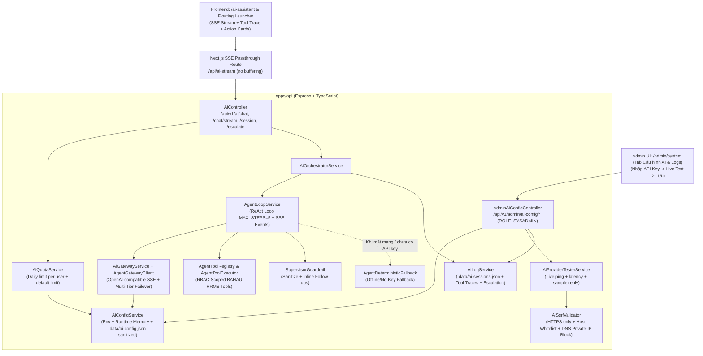

# Phase 07: Triển Khai Kiến Trúc AI Agent (MORI Pattern — Plug-and-Play API) cho BAHAU

- **Ngày lập kế hoạch:** 2026-11-25
- **Tham chiếu mẫu:** `MORI-WEDDING-STUDIO` (`apps/api/src/modules/assistance/*`, `apps/web/src/app/admin/ai/*`, `apps/web/src/app/assistant/*`)
- **Mục tiêu:** Nâng cấp hệ thống AI hiện tại của BAHAU (đang dùng rule-based `if/else` tĩnh trong `apps/api/src/services/ai-assistant.service.ts`) thành một **Tool-Calling AI Agent hoàn chỉnh với SSE Streaming, Multi-Tier Failover, SSRF Guard, Admin Control Panel ("bỏ API Key vô là chạy ngay không cần restart") và Local Deterministic Fallback**.

---

## 1. Tổng Quan Kiến Trúc (Ánh xạ 1:1 từ MORI sang BAHAU)

### Nguyên tắc cốt lõi (giống hệt MORI)
1. **Bỏ API Key vô là chạy ngay (Zero Restart):** Admin vào trang Quản trị chọn Provider (`CODEX` / OpenAI-compatible, `GROQ`, hoặc `LOCAL_ONLY`), nhập `Base URL`, `API Key`, chọn `Primary/Fallback Model`, bấm **Kiểm tra kết nối (Live Test)** rồi bấm **Lưu**. `AiConfigService` cập nhật ngay vào runtime config và áp dụng tức thì cho toàn bộ phiên chat.
2. **Bảo mật Secret & Chống SSRF:**
   - API Key **không bao giờ ghi plaintext** vào `.data/ai-config.json` (khi lưu sẽ strip key giống MORI; key mặc định nạp từ `.env` hoặc `/run/secrets/*`, key nhập từ Admin UI sống trong runtime memory; API trả về Frontend luôn mask dạng `sk-proj...xxxx`).
   - Mọi URL trước khi gọi đều qua `AiSsrfValidator`: bắt buộc `https:`, host nằm trong whitelist (`api.modelapi.vn`, `api.groq.com`, `api.openai.com`, `openrouter.ai`, `generativelanguage.googleapis.com` + biến môi trường `ALLOWED_AI_HOSTS`), resolve DNS chặn toàn bộ IP private/loopback/link-local (`127.0.0.0/8`, `10.0.0.0/8`, `172.16.0.0/12`, `192.168.0.0/16`, `169.254.0.0/16`, `::1`, `fc00::/7`), `redirect: 'error'`.
3. **Failover 4 Tầng & Không bao giờ chết trắng:**
   - **Tier 1:** Primary Model của Provider đang chọn.
   - **Tier 2:** Fallback Model của cùng Provider.
   - **Tier 3:** Cross-provider Failover (vd `CODEX` lỗi tự chuyển sang `GROQ` nếu có key, và ngược lại).
   - **Tier 4:** `AgentDeterministicFallback` — bộ máy nội bộ BAHAU (tra cứu quy chế RAG + số dư phép + soạn đơn) tự chạy khi chưa có API key hoặc provider sập.
4. **Defense-in-Depth RBAC + Human-in-the-Loop:**
   - LLM chỉ được cấp danh sách tool tương ứng với 3 Role cốt lõi của `req.user`.
   - `AgentToolExecutor` kiểm tra lại quyền `req.user` và `employeeId` trước khi gọi Service thật (chống Prompt Injection / IDOR).
   - Mọi thao tác ghi dữ liệu (tạo đơn nghỉ phép, giải trình công) chỉ trả về **Action Proposal Card** để người dùng bấm **Xác nhận** rồi mới ghi DB.

---

## 2. Thiết Kế Bộ Tool Nghiệp Vụ BAHAU (Theo 3 Role Cốt Lõi)

| # | Tên Tool | Quyền truy cập | Service BAHAU gọi tới | Loại |
|---|---|---|---|---|
| 1 | `search_dau_policies` | Tất cả (Role 1, 2, 3) | `prisma.policyKnowledge` + `defaultPolicies` (QĐ 128, QĐ 45, QyĐ 89, QĐ 210, QyĐ 15, Luật BHXH) | Read (RAG) |
| 2 | `get_my_leave_balance` | Tất cả (có `employeeId`) | `LeaveLedgerService.getBalance` | Read |
| 3 | `get_my_attendance_summary` | Tất cả (có `employeeId`) | `AttendanceService` (bảng công tháng hiện tại + trạng thái hôm nay) | Read |
| 4 | `get_my_payslip` | Tất cả (có `employeeId`) | `PayrollService.calculateEmployeePayslip` (Gross/Net, BHXH 10.5% & 21.5%, thuế TNCN) | Read |
| 5 | `get_my_profile_summary` | Tất cả (có `employeeId`) | `EmployeeService` / `prisma.employee` (đơn vị, chức vụ, HĐLĐ hiện tại) | Read |
| 6 | `get_hr_overview_alerts` | Role 2 (`HR_SPECIALIST`) & Role 3 (`SYSTEM_ADMIN`) | `ContractService` (HĐ sắp hết hạn) + `AttendanceService` (trạng thái kỳ công) + `DashboardService` | Read |
| 7 | `get_payroll_period_summary` | Role 2 (`HR_SPECIALIST`) & Role 3 (`SYSTEM_ADMIN`) | `PayrollService.getPeriodSummary` (tổng quỹ lương, trạng thái kỳ lương, tổng BHXH) | Read |
| 8 | `get_pending_approvals` | Role 2 (`HR_SPECIALIST`) & Role 3 (`SYSTEM_ADMIN`) | `WorkflowService.getPendingStepsForUser` | Read |
| 9 | `propose_leave_request` | Tất cả (có `employeeId`) | Trả về `ProposedAction` (`LEAVE_DRAFT`), user bấm xác nhận mới gọi `LeaveService.createLeaveRequest` | Proposal (HITL) |
| 10 | `propose_navigation` | Tất cả | Trả về `ProposedAction` (`NAVIGATE`) dẫn tới `/payroll`, `/attendance`, `/checkin`, `/leave`, `/approvals`, `/contracts`, `/employees` | Proposal (UI) |

---

## 3. Lộ Trình Triển Khai Theo 5 Phase

### Phase 1: Contracts & Types (`packages/contracts`)
**Mục tiêu:** Mở rộng schema & DTO trong `@bahau/contracts` mà vẫn **tương thích ngược 100%** với `AiChatRequestSchema` / `AiChatResponseSchema` hiện có.

- **File cập nhật:** [packages/contracts/src/ai/index.ts](file:///c:/Users/HaiChu/Documents/GitHub/BAHAU/packages/contracts/src/ai/index.ts)
- **Nội dung:**
  - Thêm các Zod schema & TypeScript types:
    - `AiProviderEnum = z.enum(["CODEX", "GROQ", "LOCAL_ONLY"])`
    - `MaskedAiConfigSchema`, `UpdateAiConfigInputSchema`, `TestAiConnectionInputSchema`, `TestAiConnectionResultSchema`
    - `AgentToolTraceItemSchema` (`id`, `tool`, `label`, `status`, `summary`, `durationMs`, `input`, `output`)
    - `AgentProposedActionSchema` (`LEAVE_DRAFT` | `NAVIGATE`)
    - `AgentMetaSchema` (`modelUsed`, `fallbackTier`, `latencyMs`, `provider`)
    - `AiEscalationRequestSchema`
  - Mở rộng `AiChatRequestSchema`: thêm optional `sessionId`, `liveContext` (`{ currentPath?: string }`).
  - Mở rộng `AiChatResponseSchema`: thêm optional `toolTraces`, `proposedActions`, `quickFollowUps`, `meta`.
- **Verification:** `npm run build --workspace=@bahau/contracts` exit 0.

---

### Phase 2: Backend AI Infrastructure (Config, SSRF, Tester, Quota, Logs, Gateway)
**Mục tiêu:** Port toàn bộ lõi hạ tầng từ MORI sang `apps/api/src/services/ai/` (chuẩn Express, không dùng NestJS decorator).

- **Thư mục mới:** `apps/api/src/services/ai/`
  1. `ai-types.ts`: Internal LLM types (`LlmToolMessage`, `LlmToolCall`, `LlmToolStepResult`, `AgentStreamEvent`, `CandidateSpec`).
  2. `ai-ssrf-validator.ts`: Port trực tiếp `isPrivateOrReservedIp` + `AiSsrfValidator.validateTargetUrl` (whitelist mặc định gồm `api.modelapi.vn`, `api.groq.com`, `api.openai.com`, `openrouter.ai`, `generativelanguage.googleapis.com` + `ALLOWED_AI_HOSTS`).
  3. `ai-config.service.ts`: Singleton service đọc `CODEX_API_KEY`, `CODEX_BASE_URL`, `GROQ_API_KEY` từ env/`/run/secrets/*`, load/save cấu hình không nhạy cảm ở `.data/ai-config.json`, mask API key, quản lý `defaultUserDailyLimit` và `userDailyLimits`.
  4. `ai-provider-tester.service.ts`: Validate SSRF + model regex, gửi test ping `/chat/completions` (`max_tokens: 30`, `redirect: 'error'`, timeout 25s), trả `{ ok, status, latencyMs, model, sampleReply, error }`.
  5. `ai-log.service.ts`: Quản lý tối đa 100 session gần nhất trong `.data/ai-sessions.json` (`recordTurn`, `markEscalated`, `addAdminReply`, `getSessions`, `getSession`, `deleteSession`, `clearSessions`).
  6. `ai-quota.service.ts`: Đếm lượt sử dụng theo ngày (`userId` + `YYYY-MM-DD` theo giờ VN), so với limit từ `AiConfigService`; trả `AppError(429, "AI_QUOTA_EXCEEDED", ...)` khi vượt hạn mức.
  7. `agent-stream-parser.ts`: Port `parseOpenAiSseStream` để parse real-time SSE chunks từ OpenAI-compatible API, ghép `tool_calls` theo index và phát status hint tiếng Việt cho từng tool BAHAU.
  8. `agent-gateway-client.ts`: `callToolCompletion` gọi `fetch` với watchdog idle timeout, fallback tự động sang non-stream nếu provider trả HTTP 400 với `stream: true`.
  9. `ai-gateway.service.ts`: Build failover candidates (Tier 1 Primary → Tier 2 Fallback → Tier 3 Cross-provider), gọi `callToolCompletion` kèm SSRF check trước khi gọi endpoint.
- **Cập nhật `.env.example` & `.gitignore`:**
  - Thêm biến mẫu: `CODEX_API_KEY`, `CODEX_BASE_URL`, `GROQ_API_KEY`, `ALLOWED_AI_HOSTS`, `BAHAU_AI_LOG_PATH`.
  - Đảm bảo `.data/` nằm trong `.gitignore` để không commit nhầm runtime config/logs.

---

### Phase 3: Backend BAHAU Agent Engine (Tools, Loop, Guardrail, Orchestrator & Routes)
**Mục tiêu:** Xây dựng vòng lặp Agent ReAct (`MAX_STEPS = 5`) gắn trực tiếp vào các domain service thật của BAHAU, tích hợp vào `AiAssistantService` và mở các route mới.

- **Các file trong `apps/api/src/services/ai/`:**
  1. `agent-prompts.ts`: System Prompt chuyên biệt cho **Trợ lý AI BAHAU (ĐH Kiến trúc Đà Nẵng)**, nhúng context an toàn của người dùng hiện tại (họ tên, vai trò trong 3 Role, đơn vị, ngày hôm nay GMT+7, trang đang mở) + quy tắc bắt buộc dùng tool để lấy số liệu thật (không bịa số lương/phép/ngày công) + format `[FOLLOWUPS: ...]` cuối câu trả lời.
  2. `agent-tool-registry.ts`: Định nghĩa OpenAI Function Calling JSON Schema cho 10 tool BAHAU + hàm `getToolsForUser(authUser)` lọc tool theo Role.
  3. `agent-tool-executor.service.ts`: Thực thi từng tool với kiểm tra RBAC lại ở tầng executor (`req.user`), timeout bảo vệ, chuẩn hóa output JSON gọn nhẹ để đưa lại cho LLM, sinh `ProposedAction` và `PolicySourceCitation`.
  4. `supervisor-guardrail.ts`: Làm sạch output LLM (gỡ ký tự thừa, trích xuất `inlineFollowUps`, chặn rò rỉ chuỗi giống API key `sk-...` / `gsk_...`), sinh `buildSmartFollowUps` phù hợp với Role 1/2/3.
  5. `agent-fallback.ts`: Bọc logic rule-based hiện có của `AiAssistantService` thành Tier 4 deterministic fallback (khi `provider === 'LOCAL_ONLY'`, chưa có API key, hoặc mọi tier LLM đều lỗi) để 100% test cũ và demo offline vẫn hoạt động mượt.
  6. `agent-loop.service.ts`: Vòng lặp ReAct `MAX_STEPS = 5` phát các SSE events (`status`, `tool_start`, `tool_done`, `delta`) y chang MORI.
  7. `ai-orchestrator.service.ts`: Điều phối `confirmDraft` (giữ nguyên luồng `LeaveService.createLeaveRequest` + `outboxEvent`), phát hiện ý định chuyển Phòng TCHC (`escalate`), chạy `AgentLoopService`, ghi `AiLogService`, phát `complete`.
- **Controllers & Routes:**
  - Cập nhật [apps/api/src/services/ai-assistant.service.ts](file:///c:/Users/HaiChu/Documents/GitHub/BAHAU/apps/api/src/services/ai-assistant.service.ts) ủy quyền sang `AiOrchestratorService` (giữ nguyên chữ ký static `chat` & `getPolicies` để không phá test cũ).
  - Cập nhật [apps/api/src/controllers/ai.controller.ts](file:///c:/Users/HaiChu/Documents/GitHub/BAHAU/apps/api/src/controllers/ai.controller.ts) & [apps/api/src/routes/v1/ai.routes.ts](file:///c:/Users/HaiChu/Documents/GitHub/BAHAU/apps/api/src/routes/v1/ai.routes.ts):
    - `POST /api/v1/ai/chat` (non-stream JSON)
    - `POST /api/v1/ai/chat/stream` (SSE `text/event-stream`, `X-Accel-Buffering: no`, `flushHeaders`)
    - `GET /api/v1/ai/session`
    - `POST /api/v1/ai/escalate`
    - `GET /api/v1/ai/policies`
  - Thêm mới `apps/api/src/controllers/admin-ai-config.controller.ts` & `apps/api/src/routes/v1/admin-ai-config.routes.ts` (mount trong `apps/api/src/routes/v1/index.ts`):
    - Bảo vệ bằng `requireAuth` + `requireRole("ROLE_SYSADMIN")` (riêng `GET /logs` và `POST /sessions/:id/reply` cho phép cả `ROLE_HR_OFFICER` để Phòng TCHC hỗ trợ trả lời).
    - Endpoints: `GET /admin/ai-config`, `PUT /admin/ai-config`, `POST /admin/ai-config/test`, `GET /admin/ai-config/logs`, `POST /admin/ai-config/sessions/:id/reply`, `DELETE /admin/ai-config/logs`, `DELETE /admin/ai-config/sessions/:id`.

---

### Phase 4: Frontend — Trợ lý AI Streaming UI & Bảng Cấu Hình Admin AI
**Mục tiêu:** Đưa trải nghiệm Agent Streaming + Tool Trace + Admin "Cắm API là chạy" lên `apps/web`.

1. **SSE Passthrough Route Handler (chống buffering trên Next.js):**
   - Tạo `apps/web/src/app/api/ai-stream/route.ts`: forward `POST` body + `Authorization`/`Cookie` header tới `${API_URL}/api/v1/ai/chat/stream` và stream nguyên `response.body` (`Content-Type: text/event-stream`, `Cache-Control: no-store, no-transform`).
2. **Nâng cấp trang `/ai-assistant` ([apps/web/src/app/ai-assistant/page.tsx](file:///c:/Users/HaiChu/Documents/GitHub/BAHAU/apps/web/src/app/ai-assistant/page.tsx)) & tách component sạch:**
   - `apps/web/src/components/ai/ai-stream-client.ts`: SSE client parse các event `status`, `tool_start`, `tool_done`, `delta`, `complete`, `error`; tự động fallback sang `POST /api/v1/ai/chat` nếu stream lỗi (y chang MORI `assistant-stream-client.ts`).
   - `apps/web/src/components/ai/AiToolTrace.tsx`: Hiển thị thanh tiến trình Agent thời gian thực (icon spinner khi `running`, check xanh + thời gian `ms` + tóm tắt khi `done`, bấm mở xem chi tiết).
   - `apps/web/src/components/ai/AiActionCard.tsx`: Render thẻ hành động tương tác (`LEAVE_DRAFT` có nút **Xác nhận gửi đơn** / **Hủy**, `NAVIGATE` có nút mở nhanh trang nghiệp vụ).
   - Quick Prompts tự thích ứng theo 3 Role (`LECTURER`, `HR_SPECIALIST`, `SYSTEM_ADMIN`) + Quick Follow-up chips sau mỗi lượt trả lời + nút **Chuyển Phòng TCHC hỗ trợ** (`escalate`) + đồng bộ phản hồi từ Admin/HR qua `GET /api/v1/ai/session`.
   - Thêm nút mở nhanh **AI Trợ lý** tinh gọn trên topbar của [Shell.tsx](file:///c:/Users/HaiChu/Documents/GitHub/BAHAU/apps/web/src/components/Shell.tsx) (cạnh nút "Trạm Check-in Kiosk") để cả 3 Role truy cập 1-click mà không làm phình sidebar.
3. **Trang / Tab Cấu hình AI Agent cho Admin (Role 3):**
   - Tích hợp thêm Tab thứ 5 **"AI Agent & API"** ngay trong [apps/web/src/app/admin/system/page.tsx](file:///c:/Users/HaiChu/Documents/GitHub/BAHAU/apps/web/src/app/admin/system/page.tsx) (tách thành component `apps/web/src/components/admin/AdminAiControlPanel.tsx` để không làm phình file `admin/system/page.tsx` đang 1553 dòng!):
     - **Sub-tab 1 — Cấu hình Provider & API Key:**
       - Chọn 3 chế độ: `OpenAI-Compatible (ModelAPI / OpenAI / OpenRouter / Gemini)` | `Groq Cloud` | `Local Fallback`.
       - Form nhập `Base URL`, `API Key` (hiển thị badge "Đã cấu hình: `sk-...xxxx`"), `Primary Model`, `Fallback Model` (có preset chọn nhanh + cho phép gõ model tùy ý), `Temperature`, `Timeout (ms)`, `Giới hạn lượt/ngày`.
       - Nút **✦ Kiểm tra kết nối (Live Test)** và **Lưu cấu hình hệ thống** với feedback rõ ràng (độ trễ ms, model phản hồi, câu trả lời mẫu hoặc lý do lỗi).
     - **Sub-tab 2 — Nhật ký Hội thoại & Tool Inspector:**
       - Xem danh sách các phiên chat, model đã dùng, `fallbackTier`, độ trễ, danh sách `toolTraces` (input/output JSON), lọc các phiên đang `needsHumanSupport`, và form cho Admin/HR gửi phản hồi trực tiếp vào phiên.

---

### Phase 5: Kiểm Thử & Verification Gate
**Mục tiêu:** Đảm bảo không phá bất kỳ chức năng cũ nào và toàn bộ cơ chế mới hoạt động tin cậy cả khi có API key lẫn offline.

1. **Build & Typecheck:**
   - `npm run build --workspace=@bahau/contracts`
   - `npx tsc --noEmit -p apps/api/tsconfig.json`
   - `npx tsc --noEmit -p apps/web/tsconfig.json`
2. **Automated Test Suite (`tests/ai-agent-mori-pattern.test.mjs`):**
   - **SSRF Protection:** chặn `http://`, `localhost`, `127.0.0.1`, `169.254.169.254`, host ngoài whitelist.
   - **Secret Masking & Sanitization:** verify `GET /admin/ai-config` không trả key thật và `.data/ai-config.json` không chứa API key plaintext.
   - **RBAC Enforcement:**
     - `ROLE_EMPLOYEE` không được gọi `/admin/ai-config/*` (`403`) và không thể gọi tool `get_payroll_period_summary` / `get_hr_overview_alerts`.
     - `ROLE_SYSADMIN` cấu hình, test connection, xem logs thành công.
   - **Agent Loop & Fallback:**
     - Mock OpenAI SSE server trả về `tool_calls` → verify Agent Loop gọi tool thật, emit đúng thứ tự SSE events (`status` → `tool_start` → `tool_done` → `delta` → `complete`).
     - Khi `provider = LOCAL_ONLY` hoặc không có API key → tự fallback về Tier 4 deterministic trả lời quy chế + số dư phép + tạo đơn nháp thành công.
   - **Regression Check:** Chạy lại `node tests/dashboard-ai-endpoints.test.mjs` và `node tests/security-verification.test.mjs`.

---

## 4. Các Điểm Lưu Ý & Rủi Ro Cần Kiểm Soát

| Rủi ro | Giải pháp kiểm soát |
|---|---|
| Key nhập từ Admin UI mất khi restart API container/server | Đọc ưu tiên từ `.env` (`CODEX_API_KEY`, `GROQ_API_KEY`) khi boot; ghi chú rõ trên UI: key nhập trực tiếp có hiệu lực tức thì trong phiên chạy, muốn giữ vĩnh viễn sau restart thì đặt trong `.env` (tránh lưu plaintext secret vào `.data/ai-config.json`). |
| Next.js `rewrites` có thể buffer SSE stream | Dùng Route Handler chuyên dụng `apps/web/src/app/api/ai-stream/route.ts` trả về `new Response(upstream.body, { headers: { 'Content-Type': 'text/event-stream' } })` + tự fallback sang JSON non-stream nếu lỗi. |
| Model tự bịa số liệu lương/phép hoặc vượt quyền | System prompt ép buộc gọi tool cho mọi dữ liệu cá nhân/nghiệp vụ; `AgentToolExecutor` ép buộc dùng `req.user.employeeId` (không nhận `employeeId` tự do từ LLM cho tool cá nhân) và kiểm tra Role trước khi chạy tool quản trị. |
| File `admin/system/page.tsx` quá dài (1553 dòng) | Tách toàn bộ UI Quản trị AI sang `apps/web/src/components/admin/AdminAiControlPanel.tsx` và các sub-component nhỏ, chỉ mount 1 tab mới vào `admin/system/page.tsx`. |

---

## 5. Thứ Tự Thực Thi Đề Xuất (Khi Triển Khai)
Có thể chia song song sau khi xong Phase 1 (`@bahau/contracts`):
1. **Batch 1 (Sequential):** Phase 1 — cập nhật `@bahau/contracts` và build.
2. **Batch 2 (Parallel — 2 agents):**
   - Agent A: Phase 2 + Phase 3 (Backend AI Infrastructure + Agent Loop + Tools + Routes).
   - Agent B: Phase 4 (Frontend SSE passthrough + `/ai-assistant` upgrade + `AdminAiControlPanel` + nút launcher trên `Shell`).
3. **Batch 3 (Sequential):** Phase 5 — Viết test suite mới, chạy `tsc`, regression tests và kiểm tra end-to-end.
